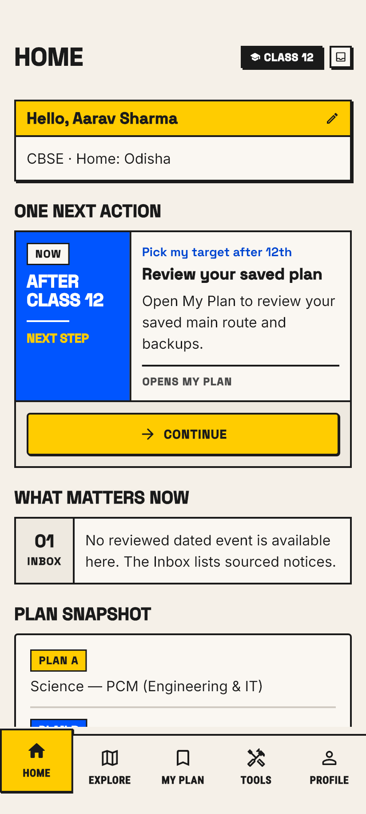
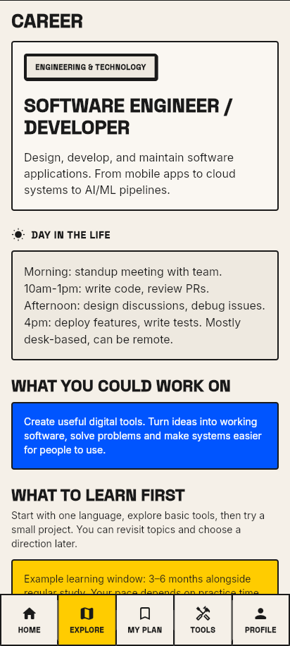
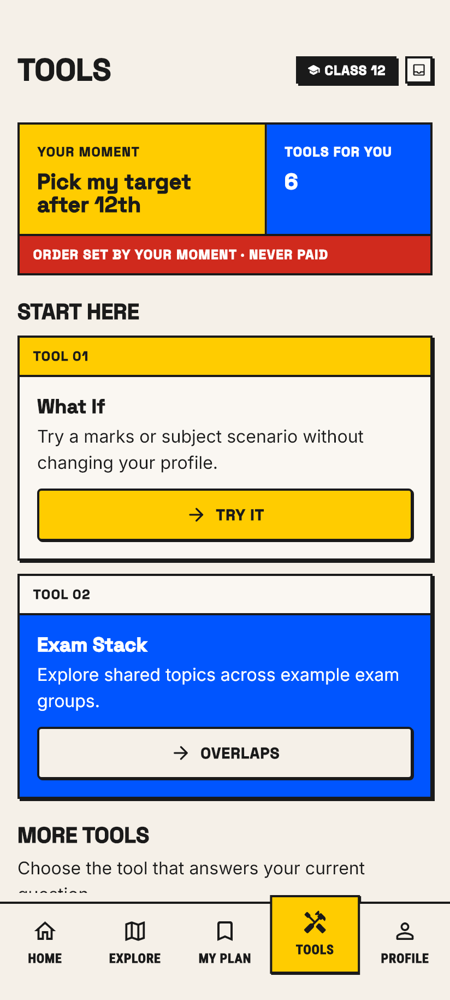
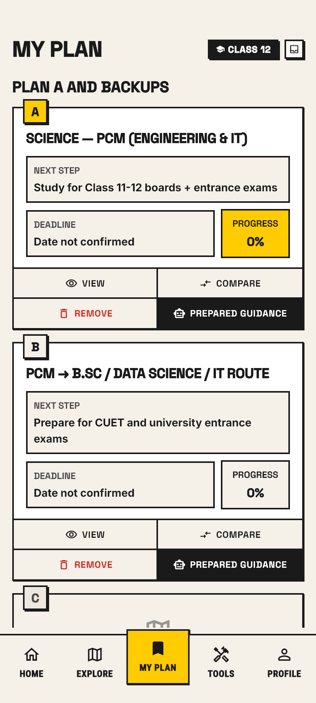

# 🧭 Mārgadarshak — मार्गदर्शक

> *"The one who shows the path."* — **The guide I needed at 16.**

**Open, source-linked data on the hidden gates Indian students face — and the career-decision app that shows those gates to students and parents in time.**

[](https://github.com/prasadsince1999/MargaDarshak/actions/workflows/validate.yml)
[](LICENSE)
[](LICENSE-CODE)
[](https://github.com/prasadsince1999/MargaDarshak/releases/tag/v1.3.0-preview.1)
[](#the-ethical-charter)

---

## Why this exists

Indian students lose seats, jobs and whole years to rules nobody showed them in time:

- a certificate issued one day too early for counselling
- a "withdraw" click that cannot be undone
- a diploma that a recruiter does not treat as Class 12
- a fee deadline missed by minutes

Courts have had to step in. In some cases the Supreme Court used its special powers to rescue a student.

These are **rule-and-date problems**. They can be caught early if the rule is written down with its source, its section and the date someone checked it.

This repository is that written-down layer, made open so anyone can check it, correct it and reuse it.

## What's in this repository

| Folder | What it is | Count |
|---|---|---|
| [`data/rule-cards/`](data/rule-cards/) | Admission, exam and recruitment rules read from the **official document**: JoSAA, MCC NEET, OJEE, SSC, Apprenticeship Rules, NTA exams and more. Each card has the source link, page/section, cycle and the date it was checked. | 36 cards (33 verified) |
| [`data/evidence/`](data/evidence/) | Public accounts of students hurt by hidden gates (Reddit, court cases, news, YouTube, forums). Each card has our summary and a link to the original. | 78 cards |
| [`data/survey-figures/`](data/survey-figures/) | Government survey figures (MoSPI: PLFS, UDISE+, NSS) for Odisha and All-India: coaching, dropout, unemployment by qualification, youth not in education or work. | 5 tables |
| [`research/`](research/) | *Show each stage the gates it faces*: a stage-by-stage study of real student problems, with 9 sourced research notes. | 1 report, 9 notes |
| [`docs/GLOSSARY.md`](docs/GLOSSARY.md) | The shared words: stage, decision moment, rule card, route, dream… | — |
| [`tools/validate_data.py`](tools/validate_data.py) | Checks every card's fields, statuses, dates and links. Runs on every pull request. | — |

### What a rule card looks like

```json
{
  "id": "od-le-tech-eligibility-2026",
  "title": "Odisha lateral entry to B.Tech: who can apply",
  "rule": "A 3-year (or 2-year lateral-entry) diploma in any branch with at least 45% (40% for reserved categories) …",
  "appliesTo": { "stages": ["diploma"], "moments": ["D"] },
  "governingBody": "Odisha Joint Entrance Examination (OJEE)",
  "document": "OJEE 2026 Information Brochure (28-01-2026)",
  "section": "Eligibility table, row 5 \"LE-TECH\", printed pp.18-19",
  "cycle": "2026",
  "status": "verified",
  "checkedOn": "2026-10-20",
  "confirmNote": "Confirm in this year's official notice before acting."
}
```

A 2026 card describes the 2026 cycle. It is **not** a promise about 2027. Card statuses are honest:

| Status | Meaning |
|---|---|
| `verified` | read in the primary document, with the section given |
| `partly_verified` | some detail came only from summaries |
| `link_only` | we only link to a live official list |
| `blocked` | the official document could not be read safely, so we don't state the rule |

## How the app uses this

The Mārgadarshak Android app works out each student's **decision moment** from their education record. Examples: choosing a route after Class 10, admissions after Class 12, job or upgrade after a diploma, what to do after a degree.

It then shows the rule cards that apply to that moment, with their source and check date. It never says "you are eligible" where the official authority decides, such as a diploma holder applying for a "+2 or equivalent" exam.

The **app source code is private.** This data, the research and the validator are open.

<table>
<tr><th>Home · a useful next step</th><th>Career · see the work</th></tr>
<tr><td align="center"></td><td align="center"></td></tr>
<tr><th>Tools · compare before deciding</th><th>My Plan · main path and a backup</th></tr>
<tr><td align="center"></td><td align="center"></td></tr>
</table>

*Screens from the 1.2.2 early-test build (7 October 2026), using a demo Class 12 profile. Feature names have since been simplified: Compare Paths, What If, Eligibility, Exam Stack, Cost Loan & ROI Calculator, Document Check, Foundation Check and Parent Mode.*

## Try the early-test app

[**Download 1.3.0 (Android 7.0+)**](https://github.com/prasadsince1999/MargaDarshak/releases/tag/v1.3.0-preview.1) · [checksum](APK-SHA256.txt) · [early-test notes](EARLY-TEST-NOTES.md) · [changelog](CHANGELOG.md)

It is a signed preview, not a Play Store launch. Start as Guest. Connected AI guidance, live updates, cloud sync and payments are **not** connected yet.

## Status, honestly

| Area | Today | Next |
|---|---|---|
| Rule cards | 36 cards; 33 read in primary documents (20 Oct 2026) | NDA/CDS, state counselling, RRB when its site is reachable |
| Evidence | 78 sourced cards; all marked "review pending" | Per-card review; Diploma, ITI, Master's and scholarship gaps |
| App | 1.3.0 preview: new education model, six-step onboarding, seven stages, seven tools | Diploma/ITI track; rule cards shown on screens |
| Live updates | Not connected | Human-reviewed notices only; news alone is never enough |

What students and testers have said so far is in [**FEEDBACK.md**](FEEDBACK.md), including the critical parts.

## Contribute

You don't need to write code. The most valuable contributions are:

1. **Correct a rule.** Found a card that's wrong or out of date? [Open a rule correction](https://github.com/prasadsince1999/MargaDarshak/issues/new?template=rule-correction.yml) with the official link and section.
2. **Add a source.** A court order, an official report or a news story about a student losing a seat to a hidden rule: [add evidence](https://github.com/prasadsince1999/MargaDarshak/issues/new?template=new-evidence.yml).
3. **Tell us what helped.** [Leave tester feedback](https://github.com/prasadsince1999/MargaDarshak/issues/new?template=tester-feedback.yml).

See [CONTRIBUTING.md](CONTRIBUTING.md). Please never post anyone's certificates, ID numbers or private records.

## The ethical charter

> **No student's future can be sold to the highest-paying institution.**

- **No pay-to-rank.** Institutions cannot buy recommendation order.
- **Sources or silence.** A rule is shown with its document, section and check date, or not at all.
- **Honest checks.** A self-check is "checked by you", never official approval.
- **Student agency.** Trade-offs are explained without shame or fear-selling.
- **Privacy.** Private student records never belong in public issues or data.

## Licence

- **Data, research and docs** (`data/`, `research/`, `docs/`, this README): [CC BY-SA 4.0](LICENSE). Please credit "Mārgadarshak open data, KSM × Tech". Linked original posts, articles and judgments belong to their authors and are not covered by this licence; we link to them rather than copy them.
- **Tools** (`tools/`, `.github/`): [AGPL-3.0-or-later](LICENSE-CODE).
- **Not licensed:** the Mārgadarshak name and logo, app screenshots and the preview APK.
- Earlier Apache-licensed distributions keep their original terms.

## Cite

```
KSM × Tech (2026). Mārgadarshak open data: source-linked rules and evidence for Indian student decisions.
https://github.com/prasadsince1999/MargaDarshak
```

---

Built by **PrasaD** at [KSM × Tech](https://ksmxtech.com), an independent product studio in Bhubaneswar, India.
*"Built on family values. Guided by truth."* — **सत्यं · मांगल्यम् · रूपान्तरम्**

[Website](https://ksmxtech.com/margadarshak/) · [Evidence library](https://ksmxtech.com/margadarshak/evidence-library/) · [Contact](mailto:support@ksmxtech.com)
